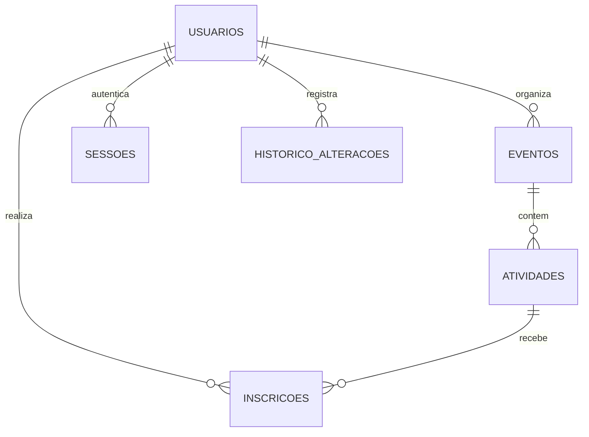

# Modelagem do banco de dados e especificação da API

Central de Eventos do ICET · versão 0.1 · 18/11/2026

Especificação técnica inicial para PostgreSQL e API HTTP em Node.js com Express. Os identificadores RF, RN e PD remetem à [documentação de requisitos](DOCUMENTACAO.md).

## 1. Premissas da primeira versão

| Tema | Proposta para implementação | Referência |
| --- | --- | --- |
| Contas | Uma conta tem um perfil. O cadastro público cria alunos. Organizadores são provisionados por procedimento interno. | PD-02, PD-03 |
| Cancelamento pelo aluno | Efetivação imediata, até o início da atividade. A vaga é liberada na mesma transação. | PD-04, RN-20 |
| Prazo de inscrição | Por atividade. A abertura é inclusiva e o encerramento é exclusivo. | PD-05, RN-16 |
| Conflito de horário | Considerar inscrições confirmadas em todos os eventos. Horários consecutivos são permitidos. | PD-06, RN-17, RN-18 |
| Publicação | O evento precisa de pelo menos uma atividade publicada. Atividades podem ser publicadas enquanto o evento está em rascunho e ficam visíveis quando ele for publicado. | PD-09, RN-07 |
| Relatórios | Contar alunos distintos com inscrição confirmada em atividade vigente do evento. Exibir inscrições canceladas quando solicitado no histórico. | PD-07, RN-29 |
| Horários | Armazenar instantes com `timestamptz`, devolver em UTC e exibir no fuso `America/Manaus`. | PD-11, RNF-07 |

Essas premissas ainda precisam de validação. A política de retenção, a recuperação de contas e eventuais bloqueios por local ou ministrante permanecem em aberto.

## 2. Modelo relacional



Todos os IDs de domínio são `uuid`, gerados no servidor. Colunas são obrigatórias, exceto as marcadas com `?`. As chaves estrangeiras de domínio usam `ON DELETE RESTRICT` para preservar o histórico. Campos de criação recebem o horário atual por padrão. Campos de atualização são mantidos pelo serviço.

| Tabela | Colunas | Restrições e valores iniciais |
| --- | --- | --- |
| `usuarios` | `id uuid PK`, `nome varchar(120)`, `email varchar(254)`, `senha_hash text`, `perfil text`, `criado_em timestamptz` | E-mail único, normalizado com remoção de espaços externos e conversão para minúsculas. Perfil `aluno` ou `organizador`. |
| `eventos` | `id uuid PK`, `organizador_id uuid FK → usuarios`, `titulo varchar(160)`, `descricao text?`, `inicio_em timestamptz`, `fim_em timestamptz`, `estado text`, `criado_em timestamptz`, `atualizado_em timestamptz`, `excluido_em timestamptz?` | `inicio_em < fim_em`. Estado inicial `rascunho`. |
| `atividades` | `id uuid PK`, `evento_id uuid FK → eventos`, `titulo varchar(160)`, `descricao text?`, `tipo varchar(60)`, `local varchar(160)`, `ministrante varchar(120)`, `inicio_em timestamptz`, `fim_em timestamptz`, `capacidade integer`, `inscricoes_abrem_em timestamptz`, `inscricoes_encerram_em timestamptz`, `estado text`, `criado_em timestamptz`, `atualizado_em timestamptz`, `excluido_em timestamptz?` | `inicio_em < fim_em`, `capacidade > 0`, `inscricoes_abrem_em < inscricoes_encerram_em <= inicio_em` (em SQL, dois testes unidos por `AND`). Estado inicial `rascunho`. |
| `inscricoes` | `id uuid PK`, `aluno_id uuid FK → usuarios`, `atividade_id uuid FK → atividades`, `estado text`, `criado_em timestamptz`, `cancelado_em timestamptz?`, `cancelado_por_id uuid FK → usuarios?`, `motivo_cancelamento text?` | Estado inicial `confirmada`. Estado `cancelada` exige data e autor. Uma inscrição confirmada tem os campos de cancelamento vazios. |
| `sessoes` | `token_hash text PK`, `usuario_id uuid FK → usuarios`, `criado_em timestamptz`, `expira_em timestamptz` | Expiração posterior à criação. Persistir apenas o hash do token. Revogar no logout removendo a sessão correspondente. |
| `historico_alteracoes` | `id uuid PK`, `entidade text`, `entidade_id uuid`, `acao text`, `autor_id uuid FK → usuarios`, `registrado_em timestamptz`, `detalhes jsonb` | A entidade identifica `evento`, `atividade` ou `inscricao`. A referência ao registro é validada pela aplicação. Gravar na mesma transação da ação, sem credenciais ou dados redundantes de inscritos. |

### 2.1 Restrições entre tabelas

- O proprietário do evento deve ter perfil de organizador. Só alunos podem criar inscrições em seu nome. Identidades e vínculos de propriedade vêm da sessão e do banco.
- Uma atividade deve estar inteiramente dentro do período do evento. Uma mudança nas datas do evento deve continuar comportando todas as suas atividades vigentes.
- Eventos e atividades seguem `rascunho → publicado → cancelado`. Também é permitido cancelar um rascunho. A exclusão lógica usa `excluido_em`.
- Cancelar um evento cancela suas atividades vigentes e suas inscrições confirmadas. Cancelar uma atividade cancela suas inscrições confirmadas. Excluir aplica esses efeitos e marca o recurso excluído na mesma transação.
- Uma atividade cancelada ou excluída não aparece no catálogo. Inscrições vinculadas permanecem acessíveis ao aluno e ao organizador responsável pelas rotas de histórico. Se a última atividade vigente sair do catálogo, o evento já publicado permanece visível com programação vazia.
- Bloquear redução de capacidade abaixo da ocupação e alteração de início ou fim de atividade com inscrições confirmadas.

As restrições de intervalo, estado e nulidade da própria linha devem ser implementadas com `CHECK`. As regras que comparam registros de tabelas diferentes devem ser aplicadas pelo serviço dentro das transações descritas a seguir.

### 2.2 Índices iniciais

| Índice | Uso |
| --- | --- |
| Único em `usuarios(email)` | Cadastro e autenticação |
| `eventos(organizador_id, inicio_em, id)` | Painel do organizador |
| `eventos(inicio_em, id)` filtrado por estado publicado e sem exclusão | Catálogo público |
| `atividades(evento_id, inicio_em, id)` | Programação e buscas por evento |
| Único em `inscricoes(aluno_id, atividade_id)` filtrado por estado confirmado | Evitar duplicidade e localizar inscrições vigentes do aluno |
| `inscricoes(atividade_id, estado, criado_em, id)` | Calcular ocupação, listar inscritos e cancelar em lote |
| `inscricoes(aluno_id, criado_em, id)` | Histórico do aluno |
| `sessoes(expira_em)` e `historico_alteracoes(entidade, entidade_id, registrado_em)` | Limpeza de sessões expiradas e consulta de histórico |

O índice único parcial preserva inscrições canceladas e permite novo registro quando o aluno se inscreve de novo. A capacidade disponível é calculada subtraindo o total de confirmações da capacidade. O total do evento usa `COUNT(DISTINCT aluno_id)` sobre as confirmações das atividades vigentes.

### 2.3 Transações e concorrência

Usar `READ COMMITTED` com bloqueios explícitos. Validar com consultas feitas após adquirir os bloqueios, usando a mesma conexão até confirmar ou desfazer a transação.

1. Na inscrição, bloquear a linha do aluno com `FOR NO KEY UPDATE` para serializar inscrições simultâneas da mesma pessoa. Bloquear o evento com `FOR SHARE` e a atividade com `FOR NO KEY UPDATE`, nessa ordem. Revalidar o vínculo e os estados após o bloqueio.
2. Em consultas posteriores ao bloqueio, verificar prazo pelo relógio do banco, duplicidade, vagas e conflito. Há conflito quando `inicio_existente < fim_novo AND inicio_novo < fim_existente`. Inserir a confirmação e seu registro de histórico na mesma transação.
3. Edições de atividade e cancelamento individual também adquirem primeiro o bloqueio compartilhado do evento e depois o exclusivo de escrita da atividade. O cancelamento pelo aluno adquire o bloqueio do aluno antes desses dois. Mutação da inscrição vem por último.
4. Alterações no evento adquirem `FOR NO KEY UPDATE` no próprio evento antes de validar ou atualizar atividades e inscrições. Operações em várias atividades as bloqueiam por ID em ordem crescente. Cancelamentos em lote atualizam as inscrições depois e não bloqueiam linhas de alunos explicitamente.

Assim, a capacidade fica protegida pelo bloqueio da atividade, os conflitos entre atividades pelo bloqueio do aluno e as transições do evento pelo bloqueio do evento. Uma tentativa de cancelamento repetida devolve o estado já cancelado e não grava outro cancelamento.

## 3. Contrato HTTP

A API está sob `/api/v1`. Enviar JSON com `Content-Type: application/json` para operações com corpo. Campos JSON usam `snake_case`. Datas de entrada usam RFC 3339 com fuso explícito. IDs em caminho devem ser UUIDs válidos.

As respostas de recurso único usam `{ "dados": { ... } }`. Listas usam `{ "dados": [], "paginacao": { "pagina": 1, "limite": 20, "total": 0 } }`. Aceitar `pagina >= 1` e `limite` de 1 a 100. Catálogo e programação ordenam por `inicio_em, id`. Inscrições ordenam por `criado_em DESC, id DESC`. A paginação usa a mesma seleção dos filtros ao calcular o total.

### 3.1 Autenticação e autorização

O login cria uma sessão com token opaco em cookie `HttpOnly`, `SameSite=Lax`, com `Secure` em produção. A proposta inicial é expirar a sessão em oito horas. Para métodos que alteram estado, validar a origem da interface contra a origem configurada. Logout revoga a sessão e remove o cookie. Senhas são armazenadas por hash, com Argon2id como escolha inicial. Login tem limitação de tentativas e resposta genérica para credenciais inválidas.

| Método e rota | Acesso | Entrada e resposta de sucesso |
| --- | --- | --- |
| `POST /auth/cadastro` | Público | `nome`, `email`, `senha`. Cria aluno. `201` com perfil público da própria conta. |
| `POST /auth/login` | Público | `email`, `senha`. `200` com a conta e cookie de sessão. |
| `POST /auth/logout` | Público | Sem corpo. `204`, inclusive se a sessão já expirou. |
| `GET /auth/me` | Autenticado | `200` com `id`, `nome`, `email` e `perfil`. |

Cadastro e login aceitam apenas os campos da tabela. A proposta inicial de senha é de 12 a 128 caracteres. Respostas da API excluem a senha, seu hash e o hash de sessão. Rotas do organizador validam o perfil e a propriedade do evento ao acessar cada recurso. Identificadores de aluno ou organizador enviados no corpo não concedem autoridade.

### 3.2 Catálogo e painel

Os caminhos da tabela são relativos a `/api/v1`. Em rotas aninhadas, confirmar que a atividade pertence ao `:eventoId` informado.

| Método e rota | Acesso | Retorno |
| --- | --- | --- |
| `GET /eventos` | Público | `200`. Eventos publicados e sem exclusão, com paginação. |
| `GET /eventos/:eventoId` | Público | `200`. Detalhes de evento publicado. |
| `GET /eventos/:eventoId/atividades` | Público | `200`. Programação publicada, ordenada para agrupamento por dia de início na interface. |
| `GET /eventos/:eventoId/atividades/:atividadeId` | Público | `200`. Atividade publicada e respectiva disponibilidade. |
| `GET /organizador/eventos` | Organizador | `200`. Eventos próprios com paginação. Filtro opcional `estado`. |
| `POST /organizador/eventos` | Organizador | `201`. Cria evento em rascunho. |
| `GET /organizador/eventos/:eventoId` | Dono | `200`. Detalhes do evento. |
| `PATCH /organizador/eventos/:eventoId` | Dono | `200`. Atualiza os campos editáveis do evento. |
| `POST /organizador/eventos/:eventoId/publicacao` | Dono | `200`. Publica o evento ou devolve o estado já publicado. |
| `POST /organizador/eventos/:eventoId/cancelamento` | Dono | `200`. Cancela o evento. Aceita `motivo` opcional. |
| `DELETE /organizador/eventos/:eventoId` | Dono | `204`. Exclui logicamente o evento. Repetição devolve `204`. |
| `GET /organizador/eventos/:eventoId/atividades` | Dono | `200`. Atividades do evento, com paginação e filtro opcional `estado`. |
| `POST /organizador/eventos/:eventoId/atividades` | Dono | `201`. Cria atividade em rascunho. |
| `GET /organizador/eventos/:eventoId/atividades/:atividadeId` | Dono | `200`. Detalhes da atividade. |
| `PATCH /organizador/eventos/:eventoId/atividades/:atividadeId` | Dono | `200`. Atualiza os campos editáveis da atividade. |
| `POST /organizador/eventos/:eventoId/atividades/:atividadeId/publicacao` | Dono | `200`. Publica a atividade ou devolve o estado já publicado. |
| `POST /organizador/eventos/:eventoId/atividades/:atividadeId/cancelamento` | Dono | `200`. Cancela a atividade. Aceita `motivo` opcional. |
| `DELETE /organizador/eventos/:eventoId/atividades/:atividadeId` | Dono | `204`. Exclui logicamente a atividade. Repetição devolve `204`. |

**Corpos de criação e edição.** Evento recebe `titulo`, `inicio_em` e `fim_em`, com `descricao` opcional. Atividade recebe `titulo`, `tipo`, `local`, `ministrante`, `inicio_em`, `fim_em`, `capacidade`, `inscricoes_abrem_em` e `inscricoes_encerram_em`, com `descricao` opcional. `PATCH` aceita subconjunto não vazio desses campos e valida o registro resultante. Apenas `descricao` aceita `null`. Rejeitar propriedades desconhecidas, strings obrigatórias vazias e dados fora dos limites definidos no modelo. Estados, vínculos e datas de auditoria são controlados pelas respectivas operações.

**Campos de resposta.** Eventos retornam `id`, título, descrição e intervalo. Atividades retornam `id`, `evento_id`, seus campos de criação e `vagas_disponiveis`. As respostas do painel incluem ainda `estado`. Listagens normais excluem registros com `excluido_em` preenchido. Edição e publicação a partir de `cancelado` devolvem `409`.

### 3.3 Inscrições e relatórios

| Método e rota | Acesso | Entrada e resposta de sucesso |
| --- | --- | --- |
| `POST /eventos/:eventoId/atividades/:atividadeId/inscricoes` | Aluno | Sem corpo. `201` com a inscrição confirmada. |
| `GET /me/inscricoes` | Aluno | `200`. Lista paginada própria. Filtro opcional `estado=confirmada\|cancelada`. |
| `GET /me/inscricoes/:inscricaoId` | Aluno titular | `200`. Detalhe da inscrição, inclusive no histórico. |
| `POST /me/inscricoes/:inscricaoId/cancelamento` | Aluno titular | `200`. Cancela a inscrição conforme o prazo. Aceita `motivo` opcional. |
| `GET /organizador/eventos/:eventoId/atividades/:atividadeId/inscricoes` | Dono | `200`. Lista paginada de inscritos. `estado=confirmada` por padrão. Aceita também `cancelada` ou `todas`. Inclui histórico de atividade excluída quando consultado pelo dono. |
| `GET /organizador/eventos/:eventoId/resumo-inscricoes` | Dono | `200` com `evento_id` e `participantes_distintos`. O total é zero após cancelamento ou exclusão do evento. |

Inscrições do aluno retornam `id`, `estado`, `criado_em`, `cancelado_em`, `motivo_cancelamento` e resumos de evento e atividade com ID e título. O resumo da atividade inclui também seus horários e local. O relatório do organizador inclui ID e nome do aluno, estado e datas da inscrição. O motivo de cancelamento é limitado a 500 caracteres. Para acessar o histórico de um recurso excluído pelo painel, usar seu ID nas rotas de inscrições.

Exemplo de corpo para criar evento:

```json
{
  "titulo": "Connect Tech",
  "descricao": "Programação acadêmica do ICET",
  "inicio_em": "2027-03-18T08:00:00-04:00",
  "fim_em": "2027-03-19T18:00:00-04:00"
}
```

### 3.4 Erros

Usar `{ "erro": { "codigo": "...", "mensagem": "..." } }`. Validação de campo pode acrescentar `campos`, um objeto com nomes de campos e mensagens. O cliente toma decisões pelo código, e as mensagens podem ser ajustadas para melhorar a leitura.

| HTTP | Códigos de exemplo | Quando usar |
| --- | --- | --- |
| `400` | `REQUISICAO_INVALIDA` | JSON malformado, UUID inválido ou parâmetros de consulta inválidos. |
| `401` | `NAO_AUTENTICADO`, `CREDENCIAIS_INVALIDAS` | Sessão inexistente ou expirada em rota privada, ou login inválido. |
| `403` | `ACESSO_NEGADO` | Perfil sem permissão para a operação ou origem inválida. |
| `404` | `RECURSO_NAO_ENCONTRADO` | Recurso inexistente, fora da visibilidade da rota ou pertencente a outra conta. |
| `409` | `EMAIL_EM_USO`, `SEM_VAGAS`, `INSCRICAO_DUPLICADA`, `CONFLITO_DE_HORARIO`, `PRAZO_INSCRICAO`, `PRAZO_CANCELAMENTO`, `ESTADO_INVALIDO`, `CAPACIDADE_INFERIOR_A_OCUPACAO` | Operação incompatível com a situação dos dados. |
| `422` | `DADOS_INVALIDOS` | JSON válido com campos ausentes, excedentes ou fora das regras de validação. |
| `429` | `LIMITE_DE_TENTATIVAS` | Limite de tentativas de autenticação atingido. |
| `500` | `ERRO_INTERNO` | Falha inesperada, sem detalhes internos na resposta. |

```json
{
  "erro": {
    "codigo": "SEM_VAGAS",
    "mensagem": "As vagas desta atividade foram preenchidas."
  }
}
```

## 4. Integração com a estrutura do projeto

- `config/migrations/` contém migrações nesta ordem de dependência: usuários e sessões, eventos e atividades, inscrições e histórico, índices.
- `db.js` fornece o pool de conexões e o executor de transações utilizado pelos serviços.
- `microservices/auth/`, `usuarios/`, `eventos/`, `atividades/` e `inscricoes/` concentram rotas, validação e persistência por domínio.
- `server.js` registra a API em `/api/v1` e serve a interface de `public/`.

Os cenários de aceite da seção 10 de [DOCUMENTACAO.md](DOCUMENTACAO.md) orientam a futura verificação. Confirmar especialmente a disputa simultânea da última vaga, o conflito de um aluno entre eventos, a preservação do histórico e o acesso restrito ao titular ou organizador responsável.
